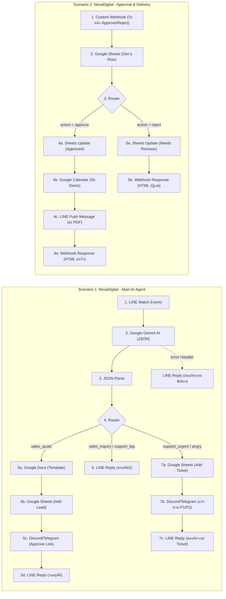

# คู่มือประกอบ Make.com ครบทั้ง 2 Scenarios (Copy-Paste Ready)
โปรเจ็ค: **NexaDigital B2B Smart Sales & Support AI Agent**

> **ก่อนเริ่ม:** ให้อัปโหลดไฟล์ในโฟลเดอร์นี้ขึ้น Google Drive ของคุณก่อน:
> 1. สร้างโฟลเดอร์ `NexaDigital_Quotations` แล้ว Share เป็น **Anyone with the link = Viewer**
> 2. อัปโหลด `Quotation_Template.html` -> คลิกขวา **Open with Google Docs** -> เมนู **File > Save as Google Docs** (ตั้งชื่อ `Quotation_Template`)
> 3. สร้าง Google Sheets ชื่อ `NexaDigital_CRM` แล้ว Import ไฟล์ `Leads_Quotations.csv` (แท็บ 1: `Leads_Quotations`) และ `Support_Tickets.csv` (แท็บ 2: `Support_Tickets`)
> 4. เตรียมช่องแจ้งเตือนทีมงาน: แนะนำสร้าง **Discord Webhook** (เข้าห้อง Discord -> Edit Channel -> Integrations -> Webhooks -> New Webhook -> Copy Webhook URL) ใช้เวลา 30 วิ ไม่ติดปัญหา Gmail OAuth

---

## ภาพรวมการทำงาน (System Architecture)



---

## ส่วนที่ 1: สร้าง Scenario 2 ก่อน (เพื่อเอา Webhook URL ไปใส่ใน Scenario 1)

ตั้งชื่อ Scenario: **`NexaDigital - Approval & Delivery`**

### Module 1: `Webhooks` -> `Custom webhook`
1. กด **Create a webhook** ตั้งชื่อ `NexaDigital_Approval_Hook` -> กด **Save**
2. **Copy Webhook URL** เก็บไว้ *(ตัวอย่าง: `https://hook.eu2.make.com/xxxxxxxxxx`)*
3. กด **Redetermine data structure** แล้วเปิดแท็บเบราว์เซอร์ใหม่วางลิงก์นี้แล้วกด Enter เพื่อให้ Make รู้จักตัวแปร `action` และ `row`:
   ```text
   https://hook.eu2.make.com/xxxxxxxxxx?action=approve&row=2
   ```
   *(เปลี่ยน `xxxxxxxxxx` เป็น URL ของคุณเอง จนขึ้นคำว่า Successfully determined)*

### Module 2: `Google Sheets` -> `Get a Row`
* **Connection:** Sign in with Google
* **Spreadsheet:** `NexaDigital_CRM`
* **Sheet Name:** `Leads_Quotations`
* **Row number:** เลือกตัวแปร `row` จาก Module 1 (`{{1.row}}`)

### Module 3: `Flow Control` -> `Router`
แตกกิ่งออกเป็น **2 เส้นทาง**:

#### กิ่งบน (Approve) — คลิกประแจระหว่าง Router กับ Module 4a ตั้ง Filter:
* **Label:** `Approved`
* **Condition:** `action` (จาก Module 1) **Equal to** `approve`

1. **Module 4a (`Google Sheets` -> `Update a Row`):**
   * Spreadsheet: `NexaDigital_CRM` | Sheet: `Leads_Quotations`
   * Row number: `{{1.row}}`
   * ช่อง `Status (K)`: พิมพ์ `Approved & Sent`
2. **Module 4b (`Google Calendar` -> `Create an Event`):**
   * *(เสริม: ใส่ Filter ก่อน Module นี้ว่า `Demo_Date` **Exists** เพื่อสร้างนัดเฉพาะเคสที่ลูกค้าระบุวันมา หรือสร้างไว้ตลอดโดยใส่ Fallback ก็ได้)*
   * **Event Name:** `นัดคุย Demo B2B - คุณ {{2.Client_Name}} ({{2.Company}})`
   * **Start Date:** `{{ifempty(parseDate(2.Demo_Date; "YYYY-MM-DD HH:mm"); addDays(now; 1))}}`
   * **End Date:** `{{addHours(ifempty(parseDate(2.Demo_Date; "YYYY-MM-DD HH:mm"); addDays(now; 1)); 1)}}`
   * **Description:** `บริการ: {{2.Service}} | งบ: {{2.Budget}} | ใบเสนอราคา: {{2.PDF_Link}}`
3. **Module 4c (`LINE` -> `Send a Push Message`):**
   * **To (User ID):** `{{2.LINE_User_ID}}`
   * **Messages -> Text:**
     ```text
     เรียนคุณ {{2.Client_Name}} ({{2.Company}})

     ใบเสนอราคาสำหรับบริการ {{2.Service}} ผ่านการตรวจสอบเรียบร้อยแล้วครับ
     📄 ดาวน์โหลดใบเสนอราคา (PDF):
     {{2.PDF_Link}}

     📅 นัดหมายคุยรายละเอียด (Demo): {{ifempty(2.Demo_Date; "แจ้งวันเวลาที่สะดวกกลับมาได้เลยครับ")}}

     หากมีคำถามเพิ่มเติมสามารถพิมพ์สอบถามในแชทนี้ได้ทันทีครับ
     ```
4. **Module 4d (`Webhooks` -> `Webhook response`):**
   * **Status:** `200`
   * **Custom Headers -> Add item:** Key = `Content-Type`, Value = `text/html; charset=utf-8`
   * **Body:**
     ```html
     <!DOCTYPE html><html lang="th"><body style="font-family:sans-serif;text-align:center;padding:60px;background:#f0fdf4;">
     <h1 style="color:#16a34a;">✅ อนุมัติและส่งใบเสนอราคาเรียบร้อยแล้ว!</h1>
     <p>ระบบได้อัปเดต CRM, ลงนัดใน Google Calendar และส่งลิงก์ PDF เข้า LINE ลูกค้าเรียบร้อยครับ</p>
     </body></html>
     ```

#### กิ่งล่าง (Reject) — ตั้ง Filter:
* **Label:** `Rejected`
* **Condition:** `action` (จาก Module 1) **Equal to** `reject`

1. **Module 5a (`Google Sheets` -> `Update a Row`):**
   * Row number: `{{1.row}}`
   * ช่อง `Status (K)`: พิมพ์ `Needs Revision`
2. **Module 5b (`Webhooks` -> `Webhook response`):**
   * **Status:** `200`
   * **Custom Headers:** Key = `Content-Type`, Value = `text/html; charset=utf-8`
   * **Body:**
     ```html
     <!DOCTYPE html><html lang="th"><body style="font-family:sans-serif;text-align:center;padding:60px;background:#fef2f2;">
     <h1 style="color:#dc2626;">❌ บันทึกสถานะ "ต้องแก้ไข" แล้ว</h1>
     <p>ระบบไม่ได้ส่งใบเสนอราคาหาลูกค้า กรุณาเข้าไปแก้ไขเอกสารและติดต่อกลับด้วยตนเองครับ</p>
     </body></html>
     ```

> กด **Save** และเปิดสวิตช์ **Scheduling = ON** ให้ Scenario 2 รันรอไว้ได้เลย!

---

## ส่วนที่ 2: สร้าง Scenario 1 (ระบบแชท AI หลักบน LINE OA)

ตั้งชื่อ Scenario: **`NexaDigital - Main AI Agent`**

### Module 1: `LINE` -> `Watch Events`
* สร้าง Webhook ด้วย Channel Access Token + Channel Secret
* นำ Webhook URL ไปวางใน **LINE Developers Console** -> กด **Verify** -> เปิด **Use webhook = ON**
* *(ตั้ง Filter หลัง Module 1: `Message: Type` **Equal to** `text` เพื่อไม่ให้ Sticker/รูปภาพทำให้ Error)*

### Module 2: `Google Gemini AI` -> `Create a Completion`
* **Connection:** ใส่ Gemini API Key
* **Model:** `gemini-2.5-flash` (หรือ Flash ล่าสุด)
* **Messages -> User -> Text:** `{{1.message.text}}`
* **Show advanced settings:**
  * **Response MIME Type:** `application/json`
  * **System Instruction:** ก๊อปทั้งหมดจากไฟล์ `system_prompt.txt` มาวาง

### Module 3: `JSON` -> `Parse JSON`
* **JSON string:** เลือก `Result` จาก Module 2

### Module 4: `Flow Control` -> `Router` (แตก 3 เส้นทางหลัก)

---

#### เส้นทางที่ 1: Sales ขอใบเสนอราคา (`sales_quote`)
* **Filter:** `intent` (จาก Parse JSON) **Equal to** `sales_quote`

1. **Module 5a (`Google Docs` -> `Create a Document from a Template`):**
   * **Document ID (Template):** เลือกไฟล์ `Quotation_Template`
   * **Title:** `QT-{{formatDate(now; "YYYYMMDD-HHmm")}}_{{3.company}}`
   * **New Document's Location:** เลือกโฟลเดอร์ `NexaDigital_Quotations`
   * **Values (แทนค่า `{{...}}`):**
     * `quote_no`: `QT-{{formatDate(now; "YYYYMMDD-HHmm")}}`
     * `date`: `{{formatDate(now; "DD/MM/YYYY")}}`
     * `valid_until`: `{{formatDate(addDays(now; 14); "DD/MM/YYYY")}}`
     * `client_name`: `{{ifempty(3.client_name; "ผู้ติดต่อ")}}`
     * `company`: `{{ifempty(3.company; "-")}}`
     * `budget`: `{{ifempty(3.budget; "ตามใบเสนอราคา")}}`
     * `service`: `{{3.service}}`
     * `scope`: `{{ifempty(3.scope; 3.service)}}`
     * `estimated_price`: `{{3.estimated_price}}`

2. **Module 5b (`Google Sheets` -> `Add a Row`):**
   * Spreadsheet: `NexaDigital_CRM` | Sheet: `Leads_Quotations`
   * `Timestamp`: `{{formatDate(now; "YYYY-MM-DD HH:mm")}}`
   * `LINE_User_ID`: `{{1.source.userId}}`
   * `Client_Name`: `{{3.client_name}}`
   * `Company`: `{{3.company}}`
   * `Service`: `{{3.service}}`
   * `Budget`: `{{3.budget}}`
   * `Estimated_Price`: `{{3.estimated_price}}`
   * `Lead_Score`: `{{3.lead_score}}`
   * `Demo_Date`: `{{3.demo_date}}`
   * `PDF_Link`: `https://docs.google.com/document/d/{{5a.Document ID}}/export?format=pdf`
   * `Status`: `Pending Approval`

3. **Module 5c (`HTTP` -> `Make a request` ส่งเข้า Discord Webhook *(หรือใช้ Telegram Bot)*):**
   * **URL:** วาง Discord Webhook URL ของคุณ
   * **Method:** `POST`
   * **Body type:** `Raw` | **Content type:** `JSON (application/json)`
   * **Request content:** *(เปลี่ยน `<SCENARIO_2_WEBHOOK_URL>` เป็น URL จาก Scenario 2)*
     ```json
     {
       "content": "🔔 **มีใบเสนอราคาใหม่รออนุมัติ (Lead Score: {{3.lead_score}})**\n👤 ลูกค้า: {{3.client_name}} ({{3.company}})\n💼 บริการ: {{3.service}} | ราคา: {{3.estimated_price}} บาท\n💰 งบประมาณ: {{3.budget}} | 📅 นัด Demo: {{3.demo_date}}\n📄 ดูไฟล์ PDF: https://docs.google.com/document/d/{{5a.Document ID}}/export?format=pdf\n\n✅ **กดอนุมัติและส่งลูกค้า:** <SCENARIO_2_WEBHOOK_URL>?action=approve&row={{5b.Row number}}\n❌ **กดปฏิเสธ/ขอแก้เอง:** <SCENARIO_2_WEBHOOK_URL>?action=reject&row={{5b.Row number}}"
     }
     ```

4. **Module 5d (`LINE` -> `Send a Reply Message`):**
   * **Reply Token:** `{{1.replyToken}}`
   * **Text:** `{{3.reply_text}}`

---

#### เส้นทางที่ 2: ตอบคำถามทั่วไป (`sales_inquiry` หรือ `support_faq`)
* **Filter:**
  * `intent` **Equal to** `sales_inquiry`
  * **OR** `intent` **Equal to** `support_faq`
  * *(AND `sentiment` **Not equal to** `angry`)*

1. **Module 6 (`LINE` -> `Send a Reply Message`):**
   * **Reply Token:** `{{1.replyToken}}`
   * **Text:** `{{3.reply_text}}`

---

#### เส้นทางที่ 3: แจ้งปัญหาด่วน / ร้องเรียน / ลูกค้าโกรธ (`support_urgent`)
* **Filter:**
  * `intent` **Equal to** `support_urgent`
  * **OR** `sentiment` **Equal to** `angry`

1. **Module 7a (`Google Sheets` -> `Add a Row`):**
   * Spreadsheet: `NexaDigital_CRM` | Sheet: `Support_Tickets`
   * `Ticket_ID`: `TKT-{{formatDate(now; "MMDD-HHmm")}}`
   * `Timestamp`: `{{formatDate(now; "YYYY-MM-DD HH:mm")}}`
   * `LINE_User_ID`: `{{1.source.userId}}`
   * `Client_Name`: `{{ifempty(3.client_name; "ลูกค้า LINE")}}`
   * `Issue_Summary`: `{{ifempty(3.issue_summary; 1.message.text)}}`
   * `Sentiment`: `{{3.sentiment}}`
   * `Priority`: `{{ifempty(3.priority; "P2")}}`
   * `Status`: `Open`

2. **Module 7b (`HTTP` -> `Make a request` ส่งเข้า Discord Webhook):**
   * **URL:** Discord Webhook URL เดิม
   * **Method:** `POST` | **Body type:** `Raw` | **Content type:** `JSON (application/json)`
   * **Request content:**
     ```json
     {
       "content": "🚨 **แจ้งเตือน Support ด่วน! [{{3.priority}}] (Sentiment: {{3.sentiment}})**\n🎫 Ticket: TKT-{{formatDate(now; \"MMDD-HHmm\")}}\n📝 ปัญหา: {{ifempty(3.issue_summary; 1.message.text)}}\nกรุณาตรวจสอบและติดต่อกลับลูกค้าด่วนครับ!"
     }
     ```

3. **Module 7c (`LINE` -> `Send a Reply Message`):**
   * **Reply Token:** `{{1.replyToken}}`
   * **Text:** `{{3.reply_text}}\n\n(หมายเลข Ticket ของคุณคือ: TKT-{{formatDate(now; "MMDD-HHmm")}})`

---

## ส่วนที่ 3: ใส่ Error Handling (เก็บคะแนนบทที่ 3 เต็ม!)
1. คลิกขวาที่ Module 2 (`Google Gemini AI`) หรือ Module 3 (`Parse JSON`) -> เลือก **Add error handler**
2. ต่อ Module `LINE` -> `Send a Reply Message`:
   * **Reply Token:** `{{1.replyToken}}`
   * **Text:** `ขออภัยครับ ระบบ AI ขัดข้องชั่วคราว ทีมงานได้รับแจ้งปัญหาแล้วและจะรีบติดต่อกลับโดยเร็วที่สุดครับ`
3. ต่อท้ายด้วย `Flow Control` -> `Ignore` (เพื่อไม่ให้ Scenario หยุดทำงานอัตโนมัติ)
4. กด **Save** และเปิด **Scheduling = ON** ทั้ง 2 Scenarios -> พร้อมทดสอบตาม `test_cases_and_demo.md` ได้เลยครับ!
