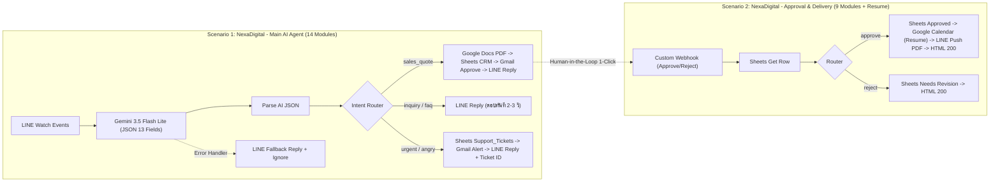

# NexaDigital B2B Smart Sales & Customer Support AI Agent

ระบบ AI Agent อัจฉริยะสำหรับคัดกรองลูกค้า B2B ออกใบเสนอราคาอัตโนมัติ (Human-in-the-Loop) และดูแลหลังการขายผ่าน **LINE OA** พัฒนาบน **Make.com** ร่วมกับ **Google Gemini 3.5 Flash Lite**

> **รายวิชา:** การพัฒนาระบบอัตโนมัติด้วยอาร์พีเอ (`ICT37867`)  
> **คณะเทคโนโลยีสารสนเทศ มหาวิทยาลัยศรีปทุม** | ภาคเรียนที่ 3 ปีการศึกษา 2569  
> **อาจารย์ผู้สอน:** อาจารย์ศักดิ์ชัย เสมอบุตร

---

## สมาชิกผู้จัดทำ
| ชื่อ–นามสกุล | รหัสนักศึกษา | บทบาท |
| :--- | :---: | :--- |
| วิภาภรณ์ ปลอดสันเทียะ | `67094859` | Project Lead & Workflow Architect |
| ทิวารัตน์ อัมฤทธิ์ | `67167139` | Prompt Engineer & Data Designer |
| ณัฐชา แล้วกระโทก | `67126501` | QA Tester & Test Case Designer |
| พลอยลดา สุขภักดีธนพงศ์ | `67171448` | Presentation & Documentation Lead |

---

## ภาพรวมสถาปัตยกรรมระบบ (System Architecture)



---

## ความสามารถหลัก (Key Features)
- **Sales Inquiry & FAQ 24/7:** ตอบราคาแพ็กเกจตาม Rate Card 4 รายการ และคำถามหลังการขาย (FAQ) ภายใน **2–3 วินาที**
- **BANT Lead Qualification & Auto-Quotation PDF:** คัดกรองคะแนน Lead (`Hot / Warm / Cold`), สร้างเอกสารใบเสนอราคาจาก Google Docs Template ครบ 8 ตัวแปร และบันทึกลง Google Sheets CRM ภายใน **7 วินาที**
- **Human-in-the-Loop (1-Click Approval):** พนักงานขายตรวจสอบไฟล์ PDF และกดปุ่ม **อนุมัติ / ปฏิเสธ** จาก Gmail เพื่ออัปเดต CRM ลงนัด Google Calendar และส่งลิงก์ PDF เข้าแชท LINE ลูกค้าอัตโนมัติใน **2.3 วินาที**
- **Support Triage & Sentiment Analysis:** จับอารมณ์ไม่พอใจ (`angry`), จัดระดับความเร่งด่วน (`P1–P3`), เปิด Ticket ลง `Support_Tickets` พร้อมแจ้งเตือนทีมงานทันที
- **Responsible AI & Error Handling:** ป้องกันการลดราคาเองและ Prompt Injection ผ่าน Guardrails พร้อม Error Handler ทั้ง 2 Scenarios (`Fallback + Ignore` ใน S1 และ `Resume` ใน S2)

---

## ผลการทดสอบเทียบกับตัวชี้วัด (KPI Results)
| ตัวชี้วัด (KPI) | กระบวนการเดิม (As-Is) | เป้าหมาย | ผลทดสอบจริง | สถานะ |
| :--- | :---: | :---: | :---: | :---: |
| เวลาตอบคำถามทั่วไป / เปิด Ticket | ~30 นาที | <= 10 วินาที | **2–3 วินาที** | ผ่าน |
| เวลาจัดทำร่างใบเสนอราคา PDF + CRM | ~45 นาที | <= 30 วินาที | **7 วินาที** | ผ่าน |
| เวลาส่งมอบหลังกดอนุมัติ (HITL) | ~15 นาที | <= 10 วินาที | **2–2.3 วินาที** | ผ่าน |
| ความถูกต้อง JSON 13 ฟิลด์และราคา | ทำด้วยมือ | >= 90% | **100% (16/16 เคส)** | ผ่าน |
| Error Handler & Guardrails | ไม่มี | 100% | **100% (ตอบใน 0.7 วิ)** | ผ่าน |

---

## โครงสร้างไฟล์ใน Repository
```text
├── README.md                                          # คู่มือภาพรวมโปรเจ็ค
├── system_prompt.txt                                  # System Prompt ฉบับใช้งานจริง (Rate Card + FAQ + Guardrails)
├── Quotation_Template.html                            # แม่แบบใบเสนอราคา 8 ตัวแปรสำหรับ Google Docs
├── Leads_Quotations.csv                               # โครงสร้างตาราง CRM (Google Sheets แท็บ 1)
├── Support_Tickets.csv                                # โครงสร้างตาราง Support Tickets (Google Sheets แท็บ 2)
├── MAKE_SETUP_GUIDE.md                                # คู่มือการตั้งค่า Make.com ทีละขั้นตอน
├── test_cases_and_demo.md                             # กรณีทดสอบทั้ง 16 เคส และสคริปต์ Live Demo 6 นาที
├── Scenario1_NexaDigital_Main_AI_Agent.blueprint.json # Make Blueprint (Scenario 1 — ลบ Webhook URL/Secret แล้ว)
├── Scenario2_NexaDigital_Approval_Delivery.blueprint.json # Make Blueprint (Scenario 2 — ลบ Webhook URL/Secret แล้ว)
└── images/                                            # แผนภาพ As-Is vs To-Be และ System Architecture
```

---

## ขั้นตอนการติดตั้งเพื่อทำซ้ำ (Reproduction Steps)
1. เตรียมบัญชีฟรี: **Make.com (Free Plan)**, **LINE Official Account (Messaging API)**, **Google AI Studio (Gemini API Key)** และ **Google Workspace**
2. อัปโหลด `Quotation_Template.html` ขึ้น Google Drive แล้วแปลงเป็น Google Docs ชื่อ `Quotation_Template` และ Import ไฟล์ `Leads_Quotations.csv` + `Support_Tickets.csv` เข้า Google Sheets ชื่อ `NexaDigital_CRM`
3. Import ไฟล์ Blueprint ทั้ง 2 ไฟล์เข้า Make.com เชื่อมต่อ Credentials ของคุณเอง (LINE, Gemini `3.5 Flash Lite`, Google, Gmail) และนำ Webhook URL ของ Scenario 2 ไปใส่ในปุ่มอนุมัติของ Scenario 1
4. เปิด `Scheduling = ON` ทั้ง 2 Scenarios แล้วทดสอบส่งข้อความผ่าน LINE OA ตาม `test_cases_and_demo.md`

> **หมายเหตุความปลอดภัย:** Repository นี้ไม่มีการจัดเก็บ API Key, Channel Access Token, OAuth Token หรือ Webhook URL จริงของระบบตามมาตรฐานความปลอดภัยข้อมูล
